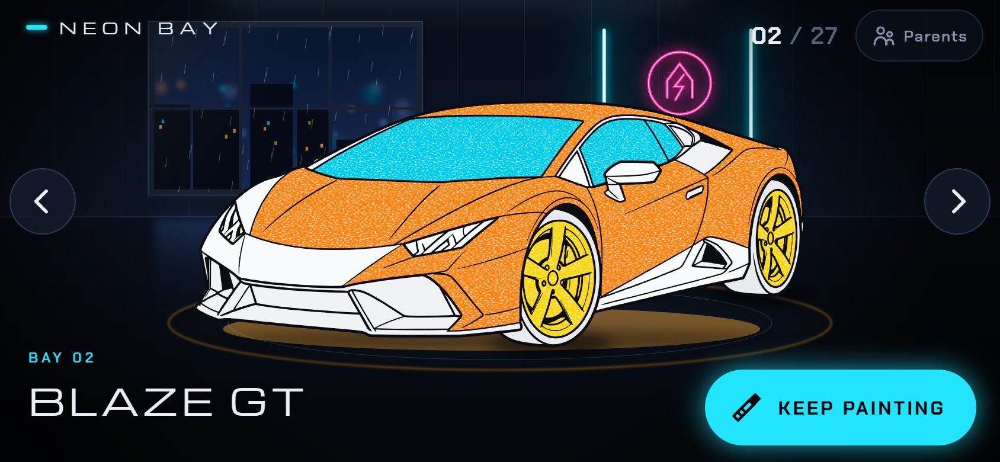
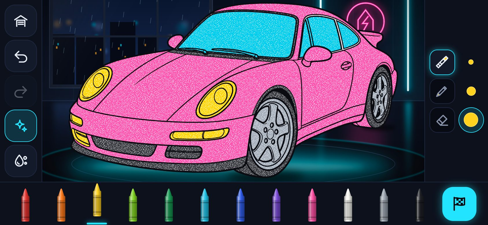
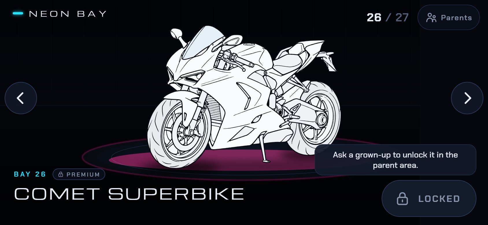
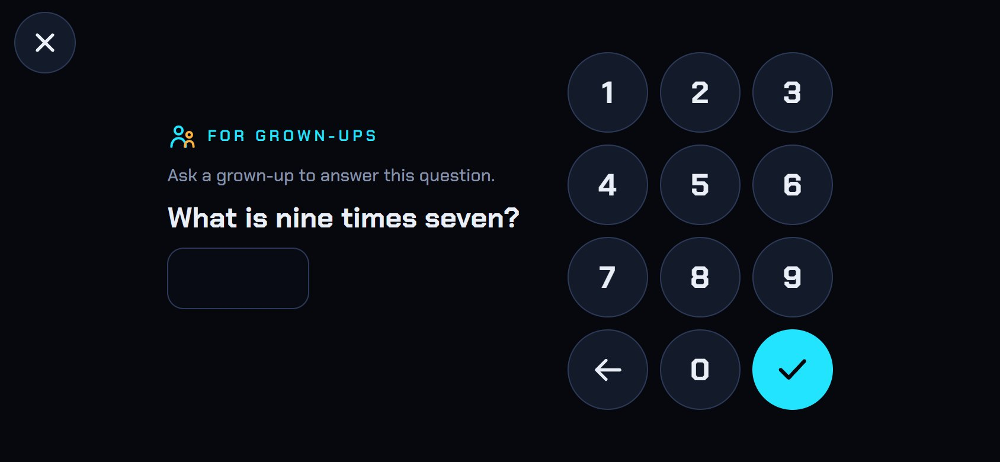
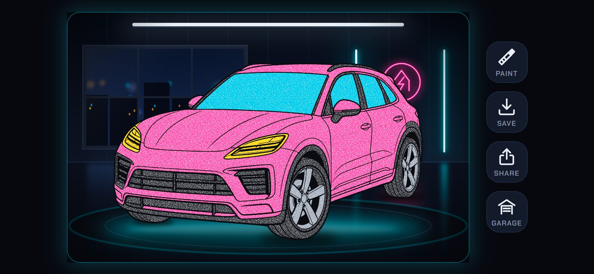
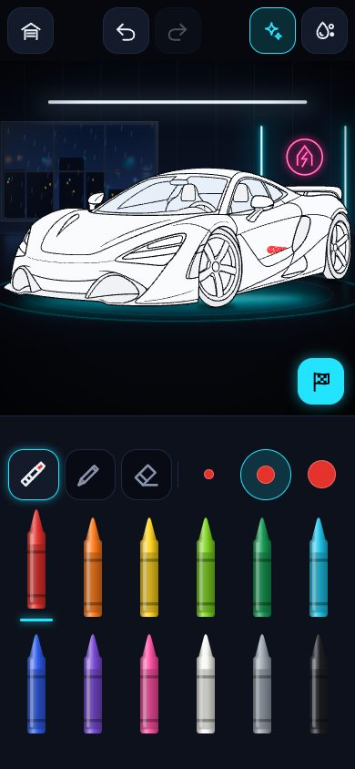
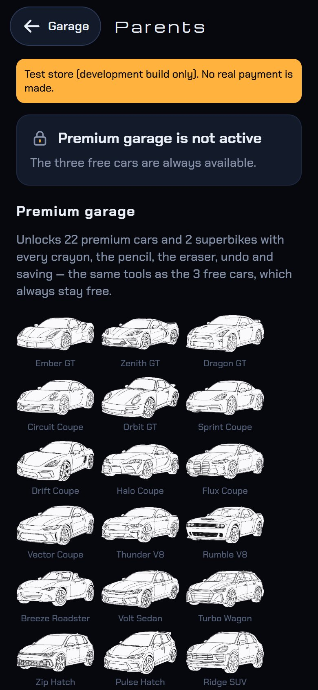
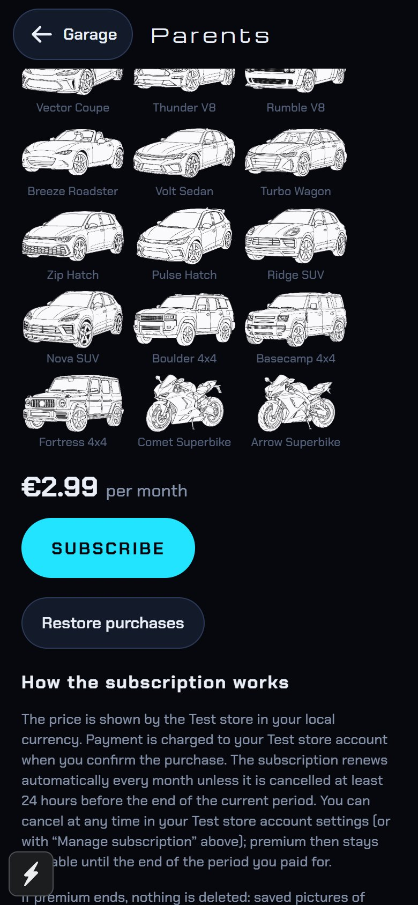

# Neon Bay

A car-colouring app for young children, built with Expo SDK 57, React Native, TypeScript and React Native Skia. The child picks a vehicle in a neon garage and colours it freehand with a wax crayon or coloured pencil. Every stroke stays inside the part where it started.

**27 vehicles:** 25 cars and 2 superbikes. Each is traced from line art in `assets/source/` into its own outlines, colourable parts and hit map. Three are always free. The rest unlock with a monthly **premium** subscription, which only a grown-up can buy, in the parent area behind a parental gate.

| # | Vehicle | Id | Kind | Access | Source (`assets/source/`) | Parts |
|---|---|---|---|---|---|---|
| 1 | Apex GT | `apex-gt` | car | **free** | `alpine-simple.png` | 37 |
| 2 | Blaze GT | `blaze-gt` | car | **free** | `01-lamborghini-huracan.png` | 32 |
| 3 | Storm Sedan | `storm-sedan` | car | **free** | `01-bmw-m5-f90.png` | 46 |
| 4 | Ember GT | `ember-gt` | car | premium | `02-ferrari-488.png` | 31 |
| 5 | Zenith GT | `zenith-gt` | car | premium | `03-chevrolet-corvette-c8.png` | 29 |
| 6 | Dragon GT | `dragon-gt` | car | premium | `09-nissan-gt-r.png` | 38 |
| 7 | Circuit Coupe | `circuit-coupe` | car | premium | `03-porsche-911-992.png` | 28 |
| 8 | Orbit GT | `orbit-gt` | car | premium | `03-orbit-gt.png` | 31 |
| 9 | Sprint Coupe | `sprint-coupe` | car | premium | `05-porsche-718-cayman.png` | 25 |
| 10 | Drift Coupe | `drift-coupe` | car | premium | `05-drift-coupe.png` | 24 |
| 11 | Halo Coupe | `halo-coupe` | car | premium | `10-toyota-supra.png` | 37 |
| 12 | Flux Coupe | `flux-coupe` | car | premium | `02-bmw-m4-g82.png` | 30 |
| 13 | Vector Coupe | `vector-coupe` | car | premium | `02-vector-coupe.png` | 26 |
| 14 | Thunder V8 | `thunder-v8` | car | premium | `08-ford-mustang.png` | 34 |
| 15 | Rumble V8 | `rumble-v8` | car | premium | `04-dodge-challenger.png` | 39 |
| 16 | Breeze Roadster | `breeze-roadster` | car | premium | `08-mazda-mx5.png` | 30 |
| 17 | Volt Sedan | `volt-sedan` | car | premium | `01-volt-sedan.png` | 27 |
| 18 | Turbo Wagon | `turbo-wagon` | car | premium | `06-audi-rs6-c8.png` | 46 |
| 19 | Zip Hatch | `zip-hatch` | car | premium | `07-volkswagen-golf-gti.png` | 38 |
| 20 | Pulse Hatch | `pulse-hatch` | car | premium | `06-pulse-hatch.png` | 31 |
| 21 | Ridge SUV | `ridge-suv` | car | premium | `04-porsche-macan.png` | 41 |
| 22 | Nova SUV | `nova-suv` | car | premium | `04-nova-suv.png` | 35 |
| 23 | Boulder 4x4 | `boulder-4x4` | car | premium | `05-toyota-land-cruiser.png` | 48 |
| 24 | Basecamp 4x4 | `basecamp-4x4` | car | premium | `06-land-rover-defender.png` | 49 |
| 25 | Fortress 4x4 | `fortress-4x4` | car | premium | `07-mercedes-g63.png` | 45 |
| 26 | Comet Superbike | `comet-superbike` | superbike | premium | `09-ducati-panigale-v4.png` | 33 |
| 27 | Arrow Superbike | `arrow-superbike` | superbike | premium | `10-yamaha-yzf-r1.png` | 36 |

The names are fictional. The app shows no manufacturer names, badges or logos, and implies no licensing. The source filenames name the real models the drawings depict; they never appear in the app. See `ASSET_MANIFEST.md` for each image's origin and rights status, which is **not established** for most of the collection.

Four screens:

- **Garage:** a swipeable carousel of the vehicles on their turntables, each wearing its own saved paint. Premium vehicles carry a small lock badge.
- **Studio:** the vehicle fills the screen, with the tools at the edges.
- **Finished:** the composed picture, with save, share and back-to-painting.
- **Parent area:** behind a parental gate. Explains premium and its price, and offers subscribe, restore and manage subscription, plus the privacy and terms links.

All vehicles and drawings are bundled and stored on the device, and everything except buying premium works offline. There are no accounts, ads, analytics or tracking, and no personal information is asked for. The only network use is the subscription check (RevenueCat and the App Store or Google Play, with an anonymous id).

| Garage (a free car, painted) | Studio |
|---|---|
|  |  |
| **A premium vehicle, locked** | **Parental gate** |
|  |  |
| **Finished (celebration)** | **Studio, portrait** |
|  |  |
| **Parent area** | **Parent area, price and terms** |
|  |  |

The screenshots come from the web build, a development build, so the parent area shows the test store's banner. Painted cars were scribbled with strokes that deliberately overshoot every part's edges.

## Run it

Requires Node 20+ (developed on Node 24) and npm.

```sh
npm install
```

`package.json` approves React Native Skia's postinstall script under npm's `allowScripts`. The script only copies prebuilt Skia binaries between local packages.

| Target | Command | Notes |
|---|---|---|
| iOS / Android development build | `npx eas-cli@latest build --profile development --platform ios` (or `android`), then `npx expo start` | Needed for real purchases (the RevenueCat SDK is native code). `expo-dev-client` is installed. Locally: `npx expo run:ios` / `run:android`. |
| Expo Go | `npx expo start` | RevenueCat runs in "Preview API mode" there (JavaScript mocks). The app never lets those unlock anything, so Expo Go shows premium as locked. **Expo Go doesn't verify billing.** The rest of the app may work; not verified. |
| Web | `npm run web` | Copies `canvaskit.wasm` into `public/`, then starts Expo web. Used for development and the automated browser checks. Development web builds include a clearly labelled **test store**. Production web sells nothing. |

Premium needs the store products and RevenueCat set up, and RevenueCat's public SDK key in `EXPO_PUBLIC_REVENUECAT_IOS_API_KEY` / `EXPO_PUBLIC_REVENUECAT_ANDROID_API_KEY`. For the exact steps and the on-device test plan, see **[docs/subscription-setup.md](docs/subscription-setup.md)**. Without a key, the three free cars work and premium stays locked.

## Checks

```sh
npm test              # unit + pixel tests (Jest, real Skia via CanvasKit), all 27 vehicles
npm run typecheck
npm run lint
npm run e2e:web       # studio, garage/all-vehicles and premium browser checks; needs `npm run web` on :8081
npm run build:regions # rebuild every vehicle's masks, line art, hit map and thumbnail
                      #   `-- --only <id> --preview` for one vehicle with review images in .scratch/
npm run trace:atlas -- assets/source/<image>.png   # numbered area atlas for authoring a new vehicle
npm run previews      # render composition previews to .scratch/
```

## Free and premium

- **Who is free:** only the vehicles in `FREE_VEHICLE_IDS` (`src/content/collection.ts`): `apex-gt`, `blaze-gt`, `storm-sedan`. They are free permanently, with no time limit or watermark. Position never matters: reordering the garage changes nothing about access (tested with the list reversed).
- **Garage order:** the free vehicles first, then premium (supercars, coupes, muscle cars, roadster, saloons and hatches, SUVs and off-roaders, superbikes).
- **Who decides:** premium is active only while RevenueCat reports the `neon_bay_premium` entitlement as active **and** its signature verified (trusted entitlements: `VERIFIED` or `VERIFIED_ON_DEVICE`). The app stores no premium flag of its own, so nothing saved on the device can unlock anything. The Expo Go preview mode and an unconfigured build never unlock anything.
- **Enforced twice:** in the garage, and again in the studio route, so a link or an old back-stack entry can't paint a locked vehicle.
- **A locked vehicle in the garage:** visible, with a small lock badge and a quiet "Locked" button. Tapping it shows one calm line, "Ask a grown-up to unlock it in the parent area.", for a few seconds. It never shows a price, a purchase sheet, a countdown, a flashing prompt or a repeated popup.
- **When premium ends** (expiry, cancellation, refund or revocation), **nothing is deleted.**
  - Vehicles with saved paint show "Look at it" and open look-only, with a short note.
  - Premium vehicles without paint are locked.
  - A stroke in progress when premium ends is finished and saved; only new strokes are refused.
  - Undo, redo and wash are disabled while look-only.
  - When premium returns, painting continues on the same picture.
- **Offline:**
  - The free cars always work.
  - A subscriber keeps premium offline from the SDK's device cache.
  - A refresh that fails keeps the last status the SDK reported, marked stale, and never ejects the subscriber.
  - If the very first launch has no connection, premium waits until the store can be reached.
- **Keeping the status current:** the app re-checks when it returns to the foreground (at most every 30 s), when the SDK pushes an update, and 5 s after the current period ends.

## The subscription

- **Product:** one auto-renewable monthly subscription, `neon_bay_premium_monthly`, priced at €2.99 in App Store Connect / Google Play. The app shows the store's localised price string (`priceString`) and never a hard-coded price.
- **SDK:** `react-native-purchases` 10.12.2 (RevenueCat), for Expo SDK 57.
- **Configuration for a children's app:**
  - an anonymous app-user id;
  - no subscriber attributes;
  - automatic device-identifier collection off;
  - diagnostics off;
  - the store's in-app messages not shown automatically over the child's screen;
  - log level ERROR in release builds.
- **Keys:** only public SDK keys, set at build time. A secret `sk_…` key is refused.
- **Outcomes handled:**
  - purchased (unlocks at once);
  - cancelled ("Nothing was charged");
  - pending approval (Ask to Buy: "waiting for approval", then unlocks by itself once approved);
  - network and store errors (clear messages);
  - restore: restored, or "No active subscription was found";
  - subscription management (the system sheet on iOS, the store page on Android);
  - expiry, refund and revocation (see above);
  - billing issues, which the parent area reports.
- **Code:**
  - `src/purchases/client.ts`: the SDK client on iOS and Android.
  - `client.web.ts`: no store in production; the development test store in development.
  - `src/purchases/entitlement.ts`: the access rule.
  - `src/state/premiumStore.ts`: state, refresh, expiry timer, actions. Framework-free and unit-tested with a scripted client.
  - `src/state/premium.ts`: React hooks.
- **Development test store** (web development builds only, labelled "Test store (development build only). No real payment is made."): scripted outcomes for the browser checks, exposed as `globalThis.__neonBayTestStore`. It verifies the app's handling of each outcome, **not** store billing.

## Parent area and parental gate

- **Garage → Parents** (top right) opens the gate first. So does every route under `/parents`, including deep links.
- **The question:** a multiplication of two numbers from four to nine, written **only in words** ("What is seven times eight?"). The two-digit answer is typed on a keypad.
  - Pre-readers can't read it, and a guess has about a 1-in-100 chance.
  - Each wrong answer brings a new question.
  - Three wrong answers in a row pause the gate for 30 seconds. The count and the pause survive closing and reopening the gate.
- **Gate timing:** the gate stays open for 10 minutes or until the parent area is left, whichever comes first, and is kept in memory only.
- **What checks the gate:** subscribe, restore, manage subscription and the outside links each check the gate at the moment they run.
- **What the parent area contains:**
  - what premium unlocks, with thumbnails of all 24 premium vehicles;
  - the store price;
  - auto-renewal and cancellation terms, and that nothing is deleted when premium ends;
  - restore and manage;
  - the privacy policy and terms of use links (from `app.json` → `extra.legal`; on iOS the terms fall back to Apple's standard EULA);
  - an obvious **Garage** close button.

  It promises no future additions.
- **Not configured yet:** the privacy policy and terms URLs are empty, so the parent area shows a "not configured" warning. They must be set before release.

## How colour stays inside each part

1. **The drawing defines the parts.** `scripts/build-traced-vehicle.ts` reads each vehicle's line art and treats every enclosed white area as a candidate part. Each vehicle's `src/content/vehicles/<id>/trace.ts` names its parts (`hood`, `front-door`, `windshield`, `fairing`, `front-tire`, `front-wheel`, …). It selects the white areas belonging to each part with a seed point, or with a lasso that claims small areas such as headlight segments or spoke gaps. The build then:
   - removes everything outside the vehicle. With `strictBackground` (the 20 vehicles of the collection), only white connected to the image border is background. White surfaces inside the vehicle stay opaque and paintable, and see-through gaps (between spokes, under a wing) are declared explicitly;
   - fails if an enclosed area inside the vehicle isn't assigned, unless it is tiny. Tiny gaps join, whole, the part whose paper surrounds them;
   - splits every pixel of the drawn lines between neighbouring parts, so two parts meet in the middle of the line that separates them;
   - fails if a part falls apart into pieces, unless that is declared on purpose;
   - traces each part into a closed vector path (marching squares, holes kept, even-odd fill), and the vehicle's ink into vector line art;
   - writes a one-byte-per-pixel **region-ID map** cropped to the vehicle (part paper, drawn line, or background), and a thumbnail for the parent area.
2. **Touch-down picks the part.** The touch point is converted to the vehicle's own units with the view transform used for rendering, then looked up in that vehicle's ID map:
   - On a part's paper → lock that part.
   - Background → no stroke.
   - On a drawn line → the nearest part within 10 dp is chosen, but only if it is at least 1.5 dp closer than any other. Otherwise nothing is painted.
3. **The lock holds for the whole stroke.** Each stroke is rendered in a save layer clipped by the locked part's **anti-aliased vector path**. The layer contains the stroke's coverage, soft edge and paper grain. The clip masks the full brush footprint, not just the brush centre. Leaving and re-entering keeps painting only the original part. The eraser is the same stroke with `DstOut` blending in the same clip.
4. **Outlines above the paint.** Layers, bottom to top: garage → ground shadows → light primer per part → paint → the drawing's vector line art. The same `drawStroke` serves the live preview, the paint raster, undo replay, restore and export.
5. **Coordinates.** Each vehicle keeps its own coordinate space (its source pixels). Strokes, masks, the hit map and the paint raster all use it. A per-vehicle **placement** (scale + offset, computed by the build from the silhouette) puts it on the garage turntable: centred, standing on the shared ground line, and sized to the same stage box. The superbikes, which are taller for their length, fill the stage height. The garage, the studio background and the export all go through that one placement.

Tests check, for every vehicle, that the hit map and the vector paths agree cell by cell. They also check that, with every part over-scribbled past its edges, no visible colour lands outside the part where the stroke began.

### Decisions made while tracing

Every edit is recorded in the vehicle's `trace.ts`, and every part map and lasso was reviewed over its drawing (`--preview` writes `<id>-regions.png` and `<id>-lassos.png`).

- **Parts merged where the drawing has no line between them:**
  - Orbit GT, Nova SUV, Drift Coupe and Thunder V8: "Roof and rear fender".
  - Drift Coupe: "Front body".
  - Sprint Coupe: a single "Body".
  - Zenith GT: "Hood and nose".
  - Circuit Coupe: the hood includes the right fender.
  - Ridge SUV: the hood and fenders, and "Window surround and rear".
  - Basecamp 4x4: "Hood and fender".
- **Split on purpose:** parts the drawing shows in separate pieces, such as tyre treads interrupted by a rim, a bike's tail or chain guard, and mesh grilles.
- **Separate for small hands:** small pillars, window frames, mirror bases, arches and intakes are their own parts, so they never steal paint from big panels.
- **Corrected after review:** wrong first assignments (for example tyre and rim rings swapped, a lasso reaching into a neighbouring panel) were fixed with explicit seeds or narrower lassos. One tiny pocket walled in by thick ink on the Arrow Superbike was given to the radiator after the clipping test caught one stray pixel there.

## The garage carousel

- **One vehicle at rest:** exactly one complete vehicle stands on the platform. Its two neighbours stay mounted, so a swipe starts without delay, but nothing of them is drawn. Vehicles further away are mounted only while a snap passes them.
- **Hidden means clipped:** each vehicle is clipped to its own frame (the screen plus a small margin), and a hidden vehicle's clip is empty. Skia doesn't apply a Group's opacity to `<Picture>` children, so fading pictures that way does nothing.
- **Swiping:** the finger moves the vehicles immediately, on the UI thread. On release they snap with a damped spring: about 390 ms, damping ratio 0.9, no visible bounce.
  - A flick, or a drag of 64 dp (less on narrow screens), moves one vehicle; smaller drags spring back.
  - A swipe always goes the way the finger went. A release speed pointing the other way is ignored: on the web it is estimated from a curve through the last few pointer events, and in automated tests about 1 in 15 rapid swipes got a backwards reading (`src/features/garage/swipeRelease.ts`).
  - A swipe made while the carousel is still settling counts from the vehicle being snapped to.
  - Every snap carries a token, so callbacks from interrupted snaps are ignored.
- **Buttons:** large previous/next buttons do the same, and are disabled at the ends. Quick repeated taps add up.
- **Kept in sync:** the name, BAY number, `04 / 27` counter, lock badge and action button all come from the same `GARAGE` entry and the same position. They fade out before the next fades in.
- **Actions:**
  - START PAINTING or KEEP PAINTING for a free or unlocked vehicle;
  - LOOK AT IT for a locked vehicle with saved paint;
  - LOCKED otherwise;
  - ONE MOMENT while the store's first answer is pending.
- **Previews:** each vehicle shows only its own saved colours.
- **Selection:** kept when returning from the studio, and restored after a restart.
- **Reduced motion:** vehicles swap in place halfway through a swipe (never both at once), snaps are short, and the parallax and glow stay still.

## Saving

Each vehicle saves independently under `drawings/<vehicleId>/v<assetVersion>/`, keyed by its permanent id, never by position:

- strokes and the redo stack as JSON;
- the flattened base as PNG;
- the garage preview.

Saves happen 0.7 s after each change, when the app goes to the background, and when leaving the studio. Washing or deleting one vehicle never touches another. Losing premium never deletes or hides a save.

The Apex GT's drawing from before versioned keys is moved into its `v1` folder on first load. It is copied first, and the old files are removed only after the new state is written. Concurrent readers share one migration, so it runs once. A save for another asset version is ignored rather than misplaced. Bump `assetVersion` in a vehicle's `trace.ts` whenever its parts change. If an id ever has to change, add a migration like the Apex GT's (`migrateLegacyDrawing` in `src/engine/persistence/drawingStore.ts`). Never reuse an id.

## Drawing feel

- **Tools:** wax crayon with paper grain that fills in as layers build up; smoother coloured pencil; eraser; three sizes; a 12-colour crayon box.
- **Strokes:** smoothed with Catmull-Rom interpolation. Stylus pressure (where reported) varies width; finger input uses full nominal width.
- **Touch handling:**
  - One finger draws; two fingers pinch-zoom and pan, up to 4×.
  - A quick second finger turns a new stroke into a pinch. A later second finger ends the stroke where it is.
  - A system cancel ends the stroke cleanly.
- **Undo and history:** per stroke. The 40 newest strokes stay undoable; older ones are flattened into a base raster.
- **Performance:**
  - Committed paint lives in an offscreen raster: GPU-backed on native, a CPU raster on web.
  - Static layers are cached Skia pictures. Neither drawing nor animation re-renders React.
  - Every snapshot, surface, paint and path is disposed after use. On web nothing is garbage collected, and each paint snapshot once leaked about 5 MB.

## Studio layout

- **Portrait:** top bar with garage, undo/redo, effects and wash. **Done** sits on the garage floor at the bottom-right of the drawing area, below the vehicle. Tools, sizes and two rows of crayons sit below.
- **Landscape:** navigation rail on the left, tools on the right (in two columns when one won't fit), crayons along the bottom with Done at the end.
- **Small phones on their side** (e.g. 568×320): a compact layout with all six actions in one rail and a 3 × 4 crayon box beside the vehicle.
- **Touch targets:** every control is at least 44 pt, and none overlap. This is checked automatically at seven phone and tablet sizes.

## Atmosphere

- **Ambience:** rain beyond the window, drifting floor reflections, a slow light sweep and an underglow, running on the UI thread behind the vehicle. (The reflections and underglow were meant to pulse, but they fade a Group of Pictures, which Skia ignores, so they stay at full strength.)
- **Celebration:** pressing Done plays one soft light sweep and a few sparkles.
- **Controls:** a lights button turns effects off, and the system reduce-motion setting makes everything still. Nothing flashes, and there is no audio.

## Project layout

```
src/app/                    expo-router routes: garage, studio/[vehicleId], finished/[vehicleId], parents/
src/content/
  collection.ts             free vehicle ids, entitlement and product ids
  registry.ts               the garage catalogue, in display order
  vehicles/<id>/            trace.ts (part map), regions.generated.json + thumbnail.png (built), index.ts
  vehicles/traces.ts        every vehicle's trace, for the build script
  scenes/neon-garage/       procedural background, ambient effects, vehicle stage
assets/source/              line-art source images (+ provenance notes)
src/engine/                 framework-agnostic drawing engine
src/features/               garage carousel, studio, finished screen, parent area and gate
src/purchases/              RevenueCat client (native), test store (web development), entitlement rule
src/state/                  settings, premium and parental-gate state, paint previews, drawing keys
src/ui/                     theme tokens, icons, crayon rack, buttons
scripts/                    traced-vehicle build, trace atlas, previews, app icons
__tests__/                  unit, pixel and integration tests
e2e/                        browser end-to-end checks (Playwright) and shared helpers
docs/                       subscription setup, screenshots
```

## Adding a vehicle

1. Put the line-art PNG in `assets/source/` (a transparent background works best) and record its source and rights status in `ASSET_MANIFEST.md`.
2. `npm run trace:atlas -- assets/source/<image>.png` numbers every enclosed area, with seed coordinates in a JSON file.
3. Create `src/content/vehicles/<id>/trace.ts`, modelled on a collection vehicle (`strictBackground: true`). Add it to `vehicles/traces.ts`.
4. `npm run build:regions -- --only <id> --preview`. Fix whatever the build reports, and review `.scratch/<id>-regions.png` and `<id>-lassos.png`.
5. Add an `index.ts` (`CatalogVehicle`: fictional name, description, accent, kind, thumbnail) and list it in `ORDER` in `src/content/registry.ts`. It is premium unless its id is added to `FREE_VEHICLE_IDS`.
6. Add it to `VEHICLES` in `e2e/lib.mjs`.

Ids and region ids are persisted in saved drawings, so never rename them.

## Verification status

**Verified here.** On Windows, with no Android SDK, no simulator and no iOS tooling:

- **Jest: 1294 tests in 14 suites**, rendering real pixels with Skia's CanvasKit build and every real vehicle asset.
  - **Clipping, every part of every vehicle (946 parts across 27 vehicles):** a thick crayon zig-zag overshooting the part by 40 units on every side never exceeds the part's anti-aliased mask, never reaches another part's interior, and leaves no visible colour off its own paper.
  - **Wheels and eraser:** tyre and wheel strokes stay put, and the eraser obeys the same boundaries. With every part over-scribbled, no visible paint lands outside the vehicle.
  - **Each vehicle:** the hit map and the vector paths agree, the vehicle stands centred on the shared ground line, a save and restart restores pixel-for-pixel, and the export shows the paint.
  - **Premium rules** (scripted client):
    - only verified, active entitlements unlock;
    - offline and failed refreshes keep the last status;
    - expiry is noticed at the end of the period;
    - refund, cancel, pending approval and restore are handled;
    - every action needs the open gate;
    - Expo Go preview, unconfigured and untrusted clients never unlock.
  - **Look-only mode:** it never deletes paint, and lets an active stroke finish.
  - **Gate:** a words-only question, its timing, and a pause that survives reopening. Secret keys are refused.
  - **Registry:**
    - three free vehicles first;
    - tier decided by id, unchanged when the list is reversed;
    - unique ids, artwork, masks and thumbnails;
    - saves and the remembered selection keyed by id.
  - **Swipe release rule.**
- **Browser end-to-end, 707 checks** (studio 52, garage 544, premium 111) on Expo web in headless Chromium with real mouse input:
  - **Lineup:** 27 vehicles in order. Exactly the three free vehicles open without premium; every other vehicle shows the lock badge and LOCKED.
  - **Locked vehicles:** tapping one shows only the calm line (fully on screen), never a price, purchase sheet, gate or dialog. A direct link to a locked vehicle's studio returns to the garage.
  - **Carousel, every vehicle in both directions** (arrows forwards, swipes back): name, bay, counter, lock badge and button all match, and only the vehicle and its neighbours are mounted. The pictures after swiping back are pixel-identical to arriving forwards.
  - **Carousel, more:** mid-swipe gaps; 4 and 12 quick arrow taps; 2 × 8 rapid swipes; reduced motion for all 27, including a drag that never shows two vehicles.
  - **Every vehicle's studio:** each opens its own studio. For each vehicle except the Apex GT (covered by the 52 studio checks), a stroke across into the neighbouring panel never paints it, a stroke from the tyre across the wheel stays on the tyre, undo/redo works, and the vehicle fits clear of the controls. Every vehicle also fits the studio in portrait.
  - **Restart:** the selection, premium (from the store) and all 26 painted vehicles return.
  - **Washing and migration:** washing one vehicle leaves the others painted. The Apex GT's pre-version save migrates.
  - **Sizes:** at seven phone and tablet sizes, every control is ≥ 44 pt with no overlaps, and every vehicle is on screen, fills at least 40% of it, and has none of its drawing under a control or label (measured on the vehicles' own pixels). The gate and the parent area are checked at five sizes.
  - **Parent area and gate:**
    - the gate guards both the Parents button and direct links;
    - a wrong answer gives a new question, and three pause the gate (reopening doesn't skip the pause);
    - the parent area shows the store's price, renewal and cancellation terms, every premium vehicle and no promises;
    - leaving closes the gate.
  - **Test-store purchase outcomes** (cancel, failed, pending → approved, success):
    - the messages;
    - the status card;
    - the garage unlocking live, without a restart.
  - **Restore:** nothing to restore, and a subscription bought elsewhere.
  - **Offline:** a restart keeps the subscriber (device cache), a failed refresh keeps premium (marked stale), and a first launch offline keeps premium locked while the free vehicles work.
  - **Expiry at the end of the period:** painted vehicles open look-only with their paint intact, unpainted ones are locked, and direct links are enforced.
  - **Expiry in the middle of a stroke:** the stroke finishes, is saved and survives a restart; later strokes are refused.
  - **Refund while painting:** locks at once and keeps every stroke.
  - **No page errors** in any suite.
- **Native bundling:** `npx expo export` builds the iOS and Android Hermes bundles (16.5 MB each, with all 27 vehicles). They contain the RevenueCat client and none of the web test store or other web-only code. `expo install --check` and `expo-doctor` (21/21) are clean, and typecheck and lint are clean.
- **Visual review:** every new vehicle's part map and lasso audit over its drawing, the garage, studio, gate and parent area screenshots, and the README screenshots regenerated from the web build.

**Not verified:**

- **Real billing.** No App Store Connect or RevenueCat project is connected, and no purchase, restore, renewal, Ask to Buy, expiry or refund has run against a real store. The web test store and Expo Go's preview mode check only the app's own handling. See `docs/subscription-setup.md` for the device test plan.
- **No real device or simulator:** touch feel, carousel frame rate, start-up time and memory with 27 vehicles on low-end phones, and Android back behaviour are all untested.
- Apple Pencil / Android stylus pressure, Save to Photos, the share sheet and haptics on device.

## Known limitations

- **Parts follow the drawings.** Where the artist drew no line between surfaces, they form one part (listed above). Beside a very thin line, an anti-aliased edge can tint a single pixel by a few percent.
- Very long scribbles become several undo steps, one per 1500 samples.
- In portrait the vehicle is limited by screen width. Landscape gives it most of the screen.
- The JS bundle is 16.5 MB, up from 7 MB with seven cars, because every vehicle's masks and line art (11 MB of JSON) are embedded in it. If start-up time or memory suffers on low-end devices, load each vehicle's generated data on demand as an asset instead.
- On web, saves use `localStorage` (about 5 MB), which many vehicles with long histories could exceed. Web is a development target.
- The original reference prototype required a login and was **not inspected**.
- No licence has been chosen for the project. The vehicle artwork needs a rights review before release (see `ASSET_MANIFEST.md`).
